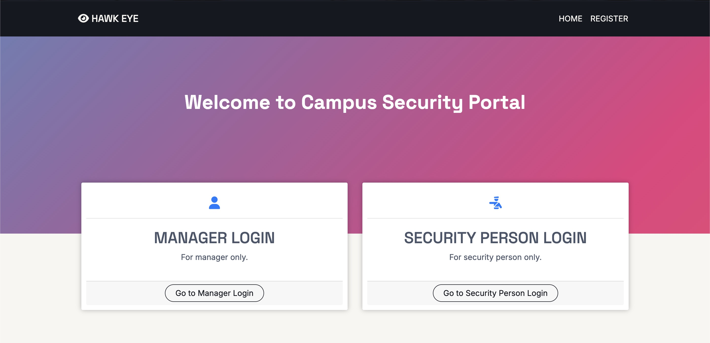
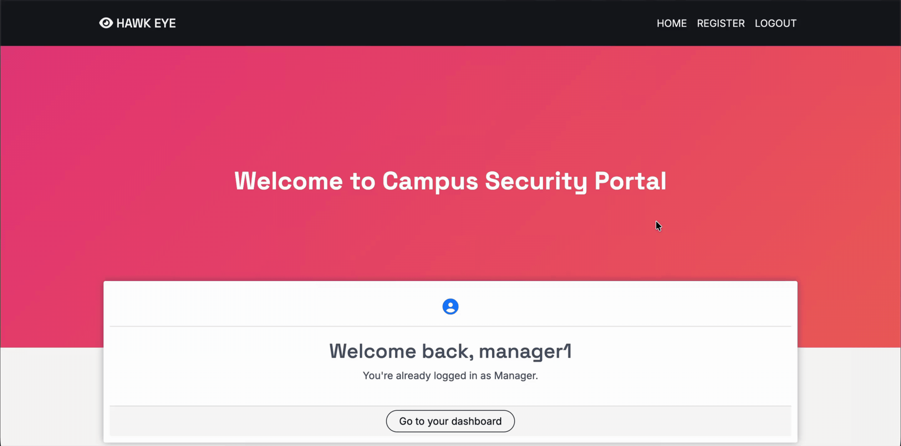
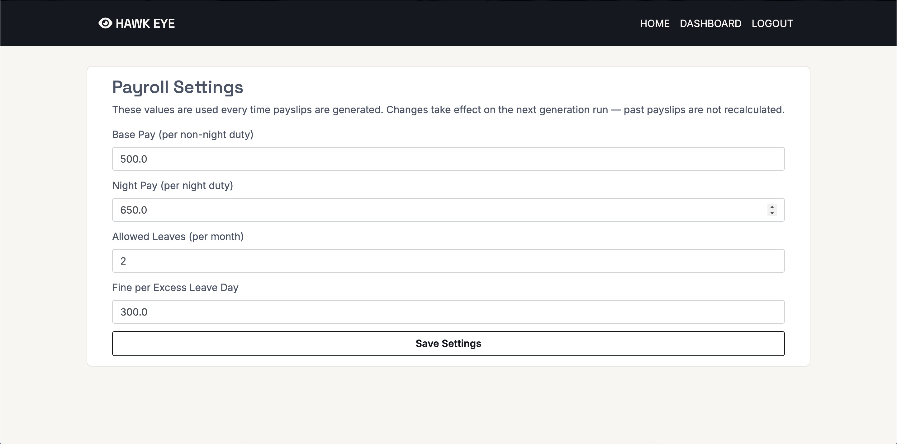
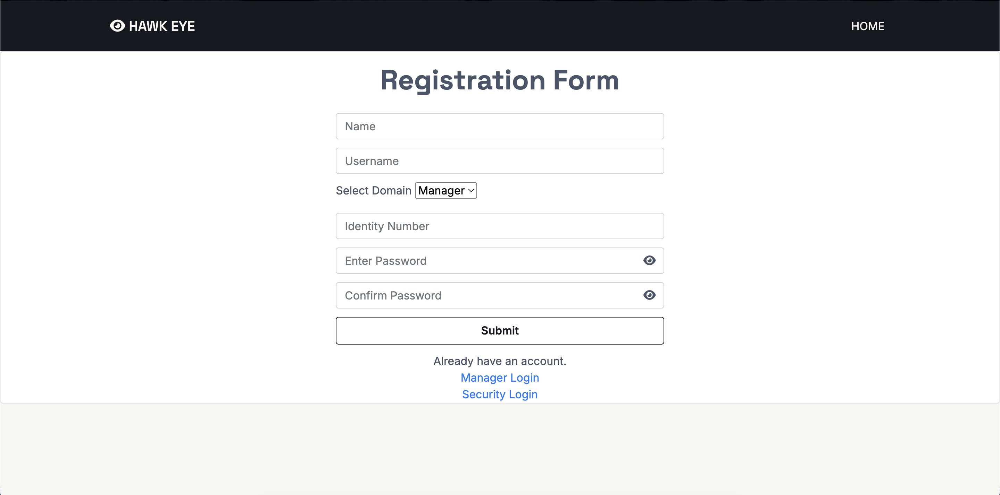
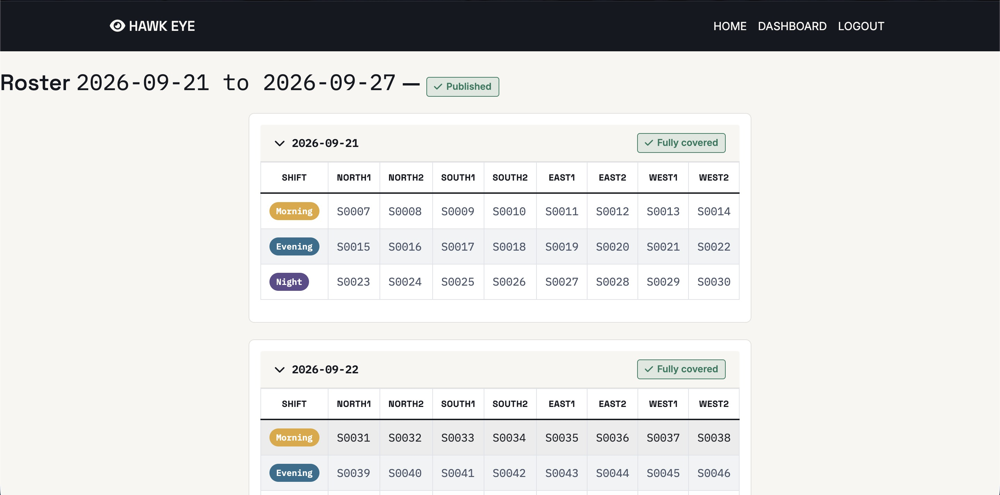
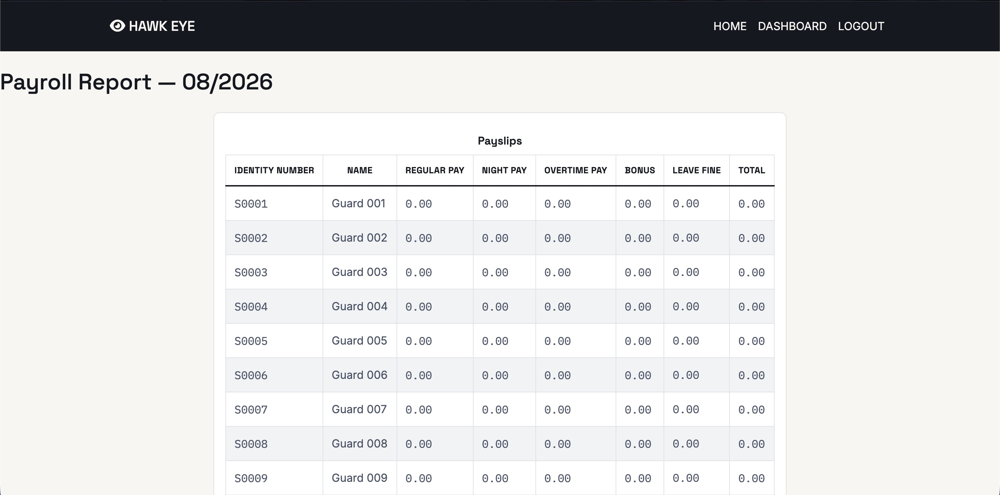
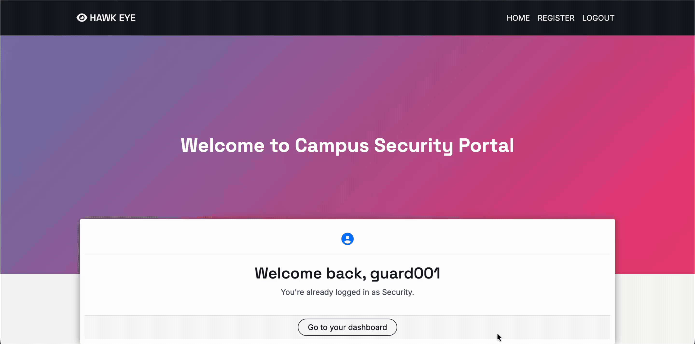

# Security Shift Manager

A Flask web app for scheduling and running a campus security guards' duty roster: a manager builds and publishes weekly shift assignments, security staff view their duties and request leave/overtime, and an admin configures the payroll rules the whole thing runs on.

Originally built as a coursework project; rebuilt since as a portfolio piece.

## Features

**Authentication**
- Three roles(Manager, Security, Admin): each with its own login route (`/ManagerLogin`, `/SecurityLogin`, `/AdminLogin`) and own database table.
- Sessions are JWT tokens (`PyJWT`, HS256) stored in an httpOnly cookie, expiring after `JWT_EXPIRY_HOURS` (default 8).
- Login is session-aware: visiting a login page while already signed in as a different role shows a flash message telling you to log out first, rather than silently overwriting the session; re-submitting your own role's login while already signed in just redirects to your dashboard.
- `/AdminLogin` isn't on the home page nav: reach it via the "Admin? Log in here" link at the bottom of the Manager login page.

**Roster generation**
- A manager picks a start date and generates a 7-day draft roster (`RosterBatch`) covering every place × shift combination for that week.
- Assignment is greedy fairness-based: for each day/shift/place, the algorithm picks the eligible security person with the fewest duties so far this month (ties broken by ID), skipping anyone already assigned that day or on approved leave for that date. A slot with no eligible candidate is recorded as an `UncoveredSlot` instead of left silently unfilled.
- A composite unique constraint (`didno`, `ddate`, `shift`) makes it impossible for one person to be double-booked into two places for the same date and shift, generated or manual.
- Drafts are reviewable and editable before going live: a manager can reassign any individual slot (re-checking the same leave/conflict rules) and then publish the batch, at which point reassignment is locked.

**Leave & overtime workflow**
- Security staff submit leave requests (start date, end date, reason); the app rejects submissions that overlap an existing pending or approved request from the same person.
- A manager approves or declines each request.
- Cancellation is two-tiered: a still-*Pending* request can be cancelled outright by the security person who filed it. An already-*Approved* request instead flips a `cancellation_requested` flag and stays Approved until the manager reviews it ->  approving turns it into `Cancelled`, declining just clears the flag and leaves the approved leave standing.
- Overtime requests follow the same Pending → Approved/Declined/Cancelled shape, with an extra check on approval: if the person has since picked up a conflicting duty for that date/shift, the request is auto-declined instead of double-booking them.

**Payroll**
- An admin sets the pay rules in `PayrollConfig`: base pay per regular duty, a higher rate per night-shift duty, an allowed number of leave days per month, and a per-day fine for every leave day beyond that allowance.
- A manager can add one-off discretionary bonuses per person per month.
- Payslip generation for a given month is manager-triggered and locked until the 1st of the *following* month (so a month's attendance/leave picture is final before payroll runs on it). The formula: `regular_pay + night_pay + overtime_pay + bonus − leave_fine`, generated once per person per month (re-running overwrites that month's figures rather than duplicating them).
- Security staff see their own payslip history; managers see a full report per generated month.

## Media

**Landing page**



**Manager dashboard** - tabs and the week/day-chip navigation in action



**Admin dashboard** : payroll settings form



**Registration page**



**Roster review** : the generated-roster accordion, with reassignment and publish controls



**Payroll report** : generated payslips for a given month



**Security dashboard** : upcoming duties, leave/overtime requests, and payslip history



## Tech stack

- **Backend:** Flask 3.1, Flask-SQLAlchemy 3.1, Flask-Bcrypt, PyJWT, python-dotenv
- **Database:** MySQL, via PyMySQL (installed as the `MySQLdb` driver)
- **Frontend:** server-rendered Jinja2 templates -> 11 standalone HTML files, no template inheritance (``/`` aren't used anywhere; each page repeats its own head/nav)
- **UI libraries (CDN):** Bootstrap 4.5.3, Font Awesome (kit), jQuery 3.5.1 (slim)
- **Design system:** a small custom layer on top of Bootstrap in `static/css/base.css` (shared CSS custom-property tokens -> colors, per-shift accent colors, status-badge colors) plus page-specific stylesheets (`dash.css`, `login.css`, `style.css`). Typography is Space Grotesk for display headings, Inter for body text, and IBM Plex Mono for tabular/mono data, all via Google Fonts.

Full dependency list in [requirements.txt](requirements.txt).

## Setup

1. **Clone and create a virtual environment**
   ```bash
   git clone <this-repo>
   cd security-shift-manager
   python3 -m venv venv
   source venv/bin/activate    # Windows: venv\Scripts\activate
   ```

2. **Install dependencies**
   ```bash
   pip install -r requirements.txt
   ```

3. **Create the MySQL database**
   ```bash
   mysql -u root -p -e "CREATE DATABASE onlinesystem;"
   ```
   (use whatever name you like, as long as it matches the `DATABASE_URL` you set below)

4. **Configure environment variables**
   ```bash
   cp .env.example .env
   ```
   Then edit `.env` and set `DATABASE_URL`, `SECRET_KEY`, and `JWT_EXPIRY_HOURS` - see [`.env.example`](.env.example) for what each one does and its default if left unset.

5. **Create the tables and seed dev data**
   ```bash
   python seed.py
   ```
   `seed.py` calls `db.create_all()` itself before seeding, so this single command both creates every table and populates dev data, you don't need a separate table-creation step first. It's safe to re-run: existing rows are matched by ID and left untouched.

   This creates:
   - 8 places (`North1`/`North2`, `South1`/`South2`, `East1`/`East2`, `West1`/`West2`)
   - 1 manager : username `manager1`
   - 1 admin : username `admin1`
   - 55 security accounts : usernames `guard001` through `guard055`
   - a starting `PayrollConfig` (illustrative values, not tuned to any real policy)

   **Every seeded account shares the password `Password123!`.**

6. **Run the app**
   ```bash
   python main.py
   ```
   This also runs `db.create_all()` (a no-op if step 5 already created the tables) before starting the Flask dev server at `http://127.0.0.1:5000/`.

   - Manager: `/ManagerLogin` → `manager1` / `Password123!`
   - Security: `/SecurityLogin` → any of `guard001`–`guard055` / `Password123!`
   - Admin: `/AdminLogin` (not linked from the home page -> reach it via the "Admin? Log in here" link at the bottom of the Manager login page, or navigate there directly) → `admin1` / `Password123!`

## Migrations

There's no migration tool (Alembic, etc.) in this project `db.create_all()` only creates tables that don't already exist, it never alters an existing one. When the schema changes in a way that affects a database that already has data in it, the raw SQL needed to bring an existing table up to date is recorded under [`migrations/`](migrations/) for reference and manual application; it's not run automatically by anything.
